# Jayasree

<p>
  
  &nbsp;&nbsp;&nbsp;&nbsp;
  
</p>

*Indic-script handwriting, animated stroke by stroke - Malayalam and Hindi so far.*

A JavaScript library that shows *how* to write a letter or word, not just what it looks like -
[Hanzi Writer](https://hanziwriter.org/) for Malayalam, Devanagari and, over time, the other Indic
scripts. Self-contained: glyph shapes are pre-computed and bundled, so there is no server, no font
file and no shaping engine at runtime.

**Try it:** <https://sachn1.github.io/jayasree/> (one demo page, a tab per language), or run it
locally with `make install && make demo` and open <http://127.0.0.1:8000/demo/>.

## Use it

```bash
npm install jayasree
```

```js
import { createStrokeWriter } from "jayasree";

const writer = createStrokeWriter(document.getElementById("stage"));
await writer.load();          // fetches glyph-data.json once
await writer.loadStrokes();   // fetches stroke-data.json (optional)
await writer.play("നന്ദി");
```

The npm package bundles Malayalam's data. Hindi's lives in `js/src/*.hi.json` and is shown in the demo.

All options and examples: [`docs/JS_API.md`](docs/JS_API.md).

## Languages

| Language | Strokes | Status |
|---|---|---|
| Malayalam | 297 hand-recorded atoms, ~2050 clusters covered | production |
| Hindi (Devanagari) | 183 atoms, all 2443 clusters covered | production - all strokes recorded and cleaned against the font |
| Tamil, Telugu, Kannada, Bengali, Sanskrit | - | planned, one at a time |

## How it works

A font is shaped once into glyph outlines; a person traces each basic letter ("atom") by hand;
the traces are centred, smoothed and straightened against the font's own outline; and the runtime
composes thousands of clusters from those few hundred atoms. Each language has its own data files
(Malayalam's are the unsuffixed ones, others carry a code such as `.hi`).

## Learn more

| | |
|---|---|
| How the pipeline works, file by file | [`docs/ARCHITECTURE.md`](docs/ARCHITECTURE.md) (and the [centering experiments](docs/CENTERING_EXPERIMENTS.md) behind it) |
| Create strokes for a font, record, process | [`docs/CREATING_HANDWRITING.md`](docs/CREATING_HANDWRITING.md) |
| Add a new language | [`docs/LANGUAGE_ONBOARDING_AGENTS.md`](docs/LANGUAGE_ONBOARDING_AGENTS.md) |
| Run it locally, repo layout, `make` commands | [`docs/DEVELOPMENT.md`](docs/DEVELOPMENT.md) |
| Contribute (commits, data rules, Malayalam freeze) | [`CONTRIBUTING.md`](CONTRIBUTING.md) |
| Code of conduct, reporting a vulnerability | [`CODE_OF_CONDUCT.md`](CODE_OF_CONDUCT.md), [`SECURITY.md`](SECURITY.md) |
| What is planned | [`docs/ROADMAP.md`](docs/ROADMAP.md) |

## License & credit

- **Code:** MIT ([LICENSE](LICENSE)).
- **Stroke data and generated artwork** (every language, no exceptions): [CC BY-SA
  4.0](https://creativecommons.org/licenses/by-sa/4.0/) - free to use, including commercially, with
  credit ("*Jayasree* by Sachin Nandakumar and contributors", linking here) and the same license.
  Details: [LICENSE-DATA](LICENSE-DATA).
- **Letterforms:** derived from [Manjari](https://smc.org.in/fonts/manjari) (Malayalam; Santhosh
  Thottingal & Swathanthra Malayalam Computing) and Noto Sans Devanagari (Hindi; The Noto Project
  Authors), both SIL OFL 1.1.
- **Prior art:** [mlmash](https://gitlab.com/smc/mlmash) by Santhosh Thottingal
  ([live](https://learn.smc.org.in)) came first and also animates Malayalam handwriting with SVG
  strokes; [his write-up](https://thottingal.in/blog/2020/10/27/learning-to-write-malayalam-svg-animation/)
  explains how.
